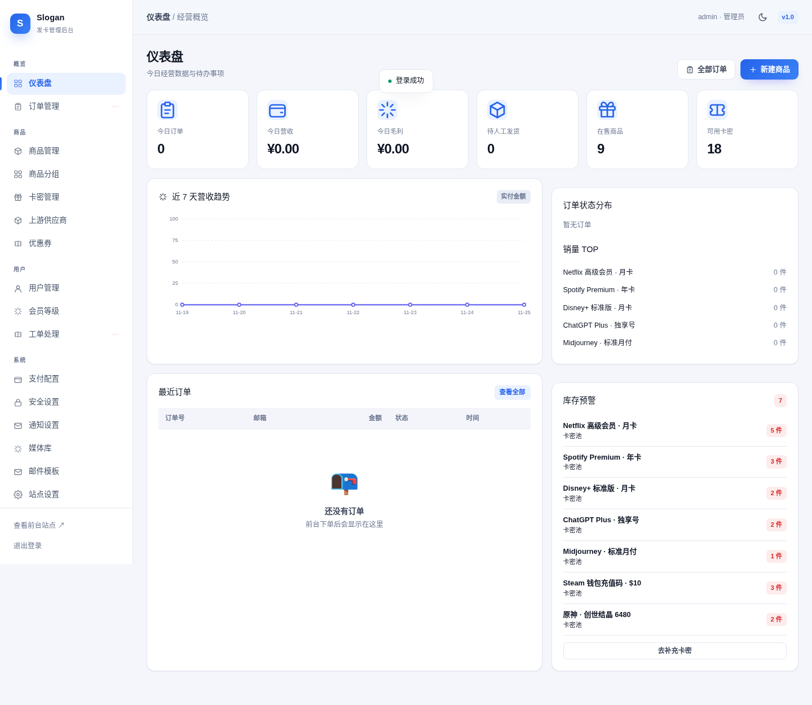
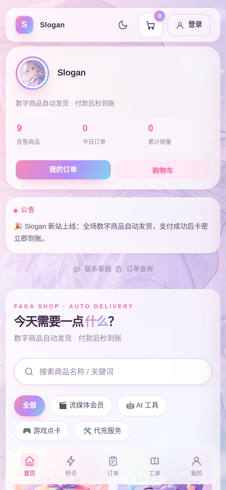
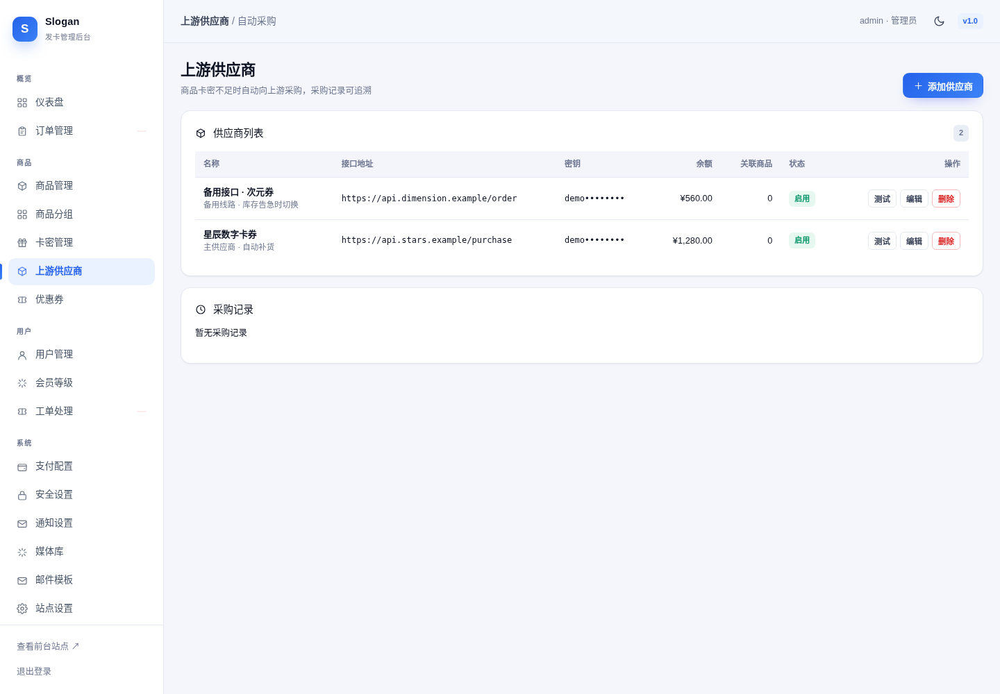
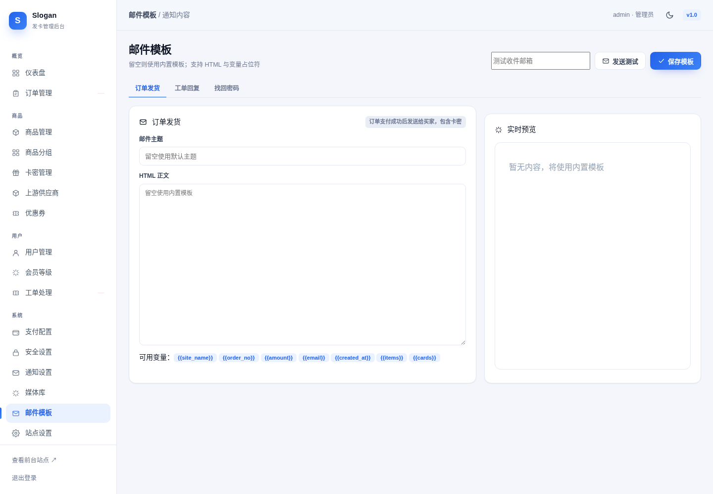
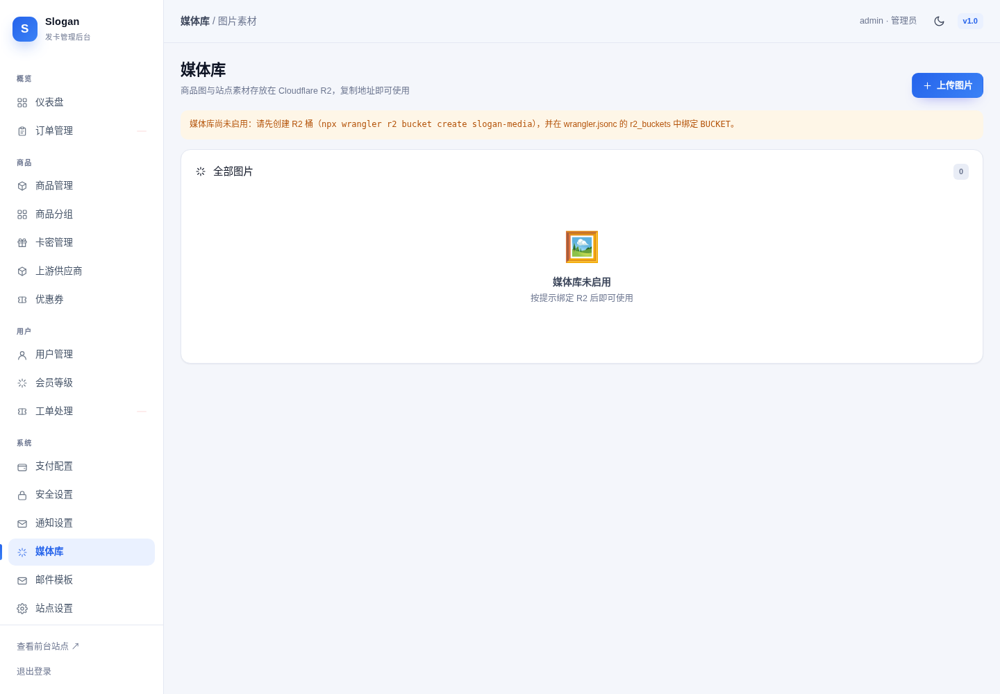
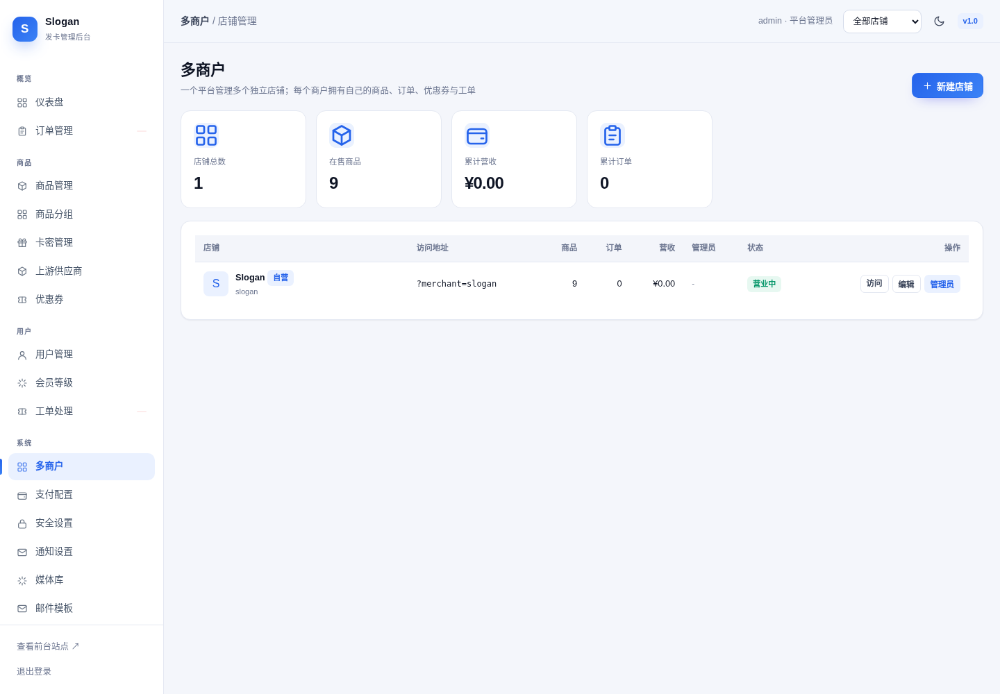
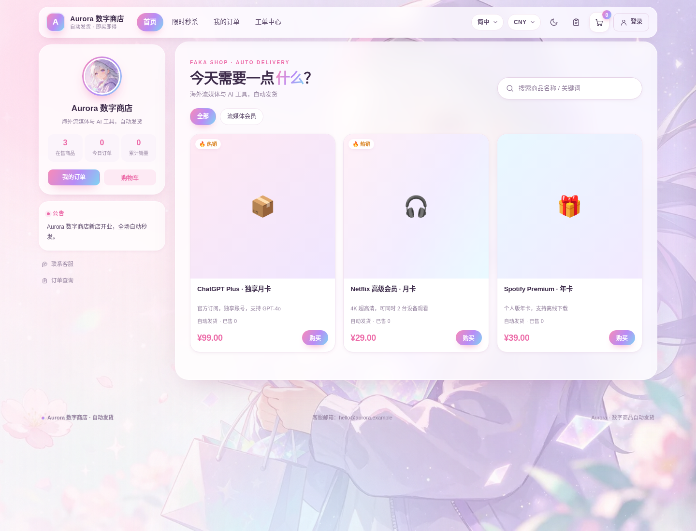
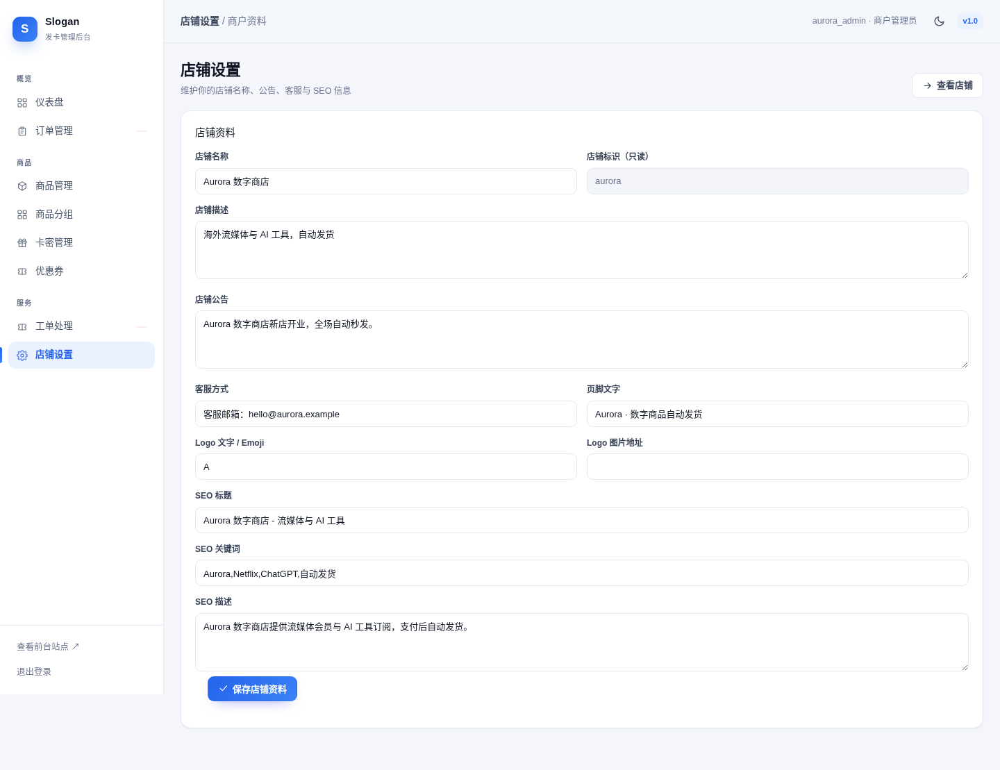

# Slogan

> **Slogan** 是一套运行在 **Cloudflare Workers + D1** 上的数字商品自动发卡系统。
> 无服务器、无需 PHP/MySQL，全球边缘节点直接运行；一条命令部署，一个 D1 数据库搞定全部数据。

| 前台商城 | 后台仪表盘 |
|---|---|
|  |  |

| 商品详情 | 移动端 |
|---|---|
|  |  |

| 上游供应商 | 邮件模板 | 媒体库 |
|---|---|---|
|  |  |  |

| 多商户管理 | 商户独立店铺 | 商户后台 · 店铺设置 |
|---|---|---|
|  |  |  |

---

## 一、这是什么

Slogan 把发卡站需要的商品、卡密、订单、支付、会员、营销、工单和通知整合进一个 Workers 原生应用：

- **前台**：粉紫二次元视觉、全屏背景、毛玻璃面板、左侧店铺卡、搜索与分类胶囊、商品库存/销量/批发价、移动端底部 Tab。
- **后台**：浅色侧栏 + 蓝色工作台，覆盖商品、分类、卡密、订单、优惠券、兑换码、用户、会员等级、工单、支付、通知、媒体库、邮件模板、上游供应商、多商户和站点设置。
- **部署**：Workers + D1 + Static Assets，`/setup` 初始化，Cron 每 5 分钟关闭超时订单。
- **扩展**：多语言（简/繁/英）、多币种（CNY/USD/JPY）、R2 媒体库、可视化邮件模板、上游供应商自动履约。

> 数据表与字段按发卡业务模型设计，金额统一以「分」为整数存储，避免浮点误差。

---

## 二、功能清单

### 商品与库存
- 多级分类（图标、排序、启停、商品计数）
- 商品多规格 SKU（独立价格 / 会员价 / 库存）
- 三种发货模式：**卡密自动发货**、**人工发货**、**固定内容发货**（实物地址版按人工处理）
- 卡密池：批量导入（`卡号----密码` / 空格 / 逗号 / 竖线 / 纯卡密 / CSV）、导出、删除、恢复
- 成本价、利润统计、库存预警（低于阈值后台高亮）
- 阶梯批发价（满 3 件 9 折、满 10 件 8 折这类）
- 限时秒杀（独立价格 + 起止时间）
- 每人限购、起购数量、单次上限
- **卡密预选**：买家可指定某张卡密，加价购买

### 订单与支付
- 购物车多商品合并结算、游客下单（邮箱即可）、会员下单
- 订单超时自动关闭并**释放预占卡密**（Cron 每 5 分钟）
- 支付渠道：**易支付（MD5）**、**支付宝当面付（RSA2）**、**USDT（BEpusdt）**、**HashPay（USDT-TRC20，HMAC Webhook 验签）**、**Stripe Checkout（Webhook 验签）**、**PayPal Orders v2（服务端 capture）**、**余额支付**、模拟支付（仅测试）
- 支付回调验签、幂等处理、回调日志
- 后台：关闭订单、人工发货（可填内容）、退款、补发卡密、订单导出
- 实物商品收货地址、买家备注

### 营销与会员
- 优惠券：百分比 / 固定立减 / 每件减免，支持最低消费、商品范围、总次数、每人限领、有效期
- 会员等级折扣（普通 / 黄金 / 铂金 / 钻石，可自定义门槛与折扣）
- 余额充值与余额支付、余额流水
- 兑换码：后台批量生成一次性余额兑换码，可设置金额、数量、前缀、有效期与备注；前台输入后余额立即到账，并写入余额流水
- 三级分销返佣（一级 10% / 二级 5% / 三级 2%，可配置）
- 邀请码、邀请关系链、佣金记录

### 多商户
- 一个后台管理多个独立店铺：商户拥有自己的商品、分组、卡密、订单、优惠券与工单，数据完全隔离
- 平台管理员顶栏可切换「全部店铺 / 指定店铺」，切换后仪表盘、商品、卡密、订单、优惠券、工单均按所选店铺统计与筛选
- 每个商户有独立的管理员账号，登录后只看到自己的数据；「店铺设置」可维护名称、Logo、公告、客服、页脚与 SEO
- 前台访问方式三选一：`?merchant=标识`、绑定子域名 / 自定义域名、直接访问默认店铺；前台请求会自动携带店铺标识，商品页、下单、支付回跳都在同一店铺内完成
- 下单会校验商品同属一个店铺，优惠券按店铺校验，订单落库记录 `merchant_id` 与 `merchant_slug`
- 平台管理员可创建商户（同时生成商户管理员，密码只显示一次）、重置管理员密码、启用/停用店铺；有业务数据的店铺只能停用、不能删除

### 兑换码充值

- 后台「兑换码」：设置每个兑换码的余额金额、生成数量（1–200）、可选前缀、有效期和备注，生成后会自动弹出完整码列表，支持一键复制。
- 兑换码为一次性使用；已使用、已停用或已过期的码不能再次兑换。后台可停用未使用的码，已使用的记录保留使用人和时间。
- 前台个人中心右上角菜单和「个人中心 → 兑换码充值」均可进入 `/redeem`，输入兑换码后余额立即到账，并记录一条 `redeem` 类型的余额流水。
- 相关接口：`POST /api/auth/redeem`（用户兑换）、`GET/POST/PUT /api/admin/redeem-codes`（后台管理）。

### 多语言与多币种
- 前台内置 **简体中文 / 繁体中文 / English** 三套界面文案，顶部一键切换，选择持久化到浏览器
- 支持 **CNY / USD / JPY** 展示币种与汇率（后台可改），价格按 `Intl.NumberFormat` 格式化，日元自动取整
- 翻译采用 DOM 文本节点 + placeholder 自动替换，商品名 / 分类名等数据内容保持原样

### 媒体库
- Cloudflare **R2** 直传（5 MB 单文件上限，仅图片）
- 列表、复制外链、删除；公开访问 `/media/*` 并带长缓存
- 商品编辑器的图片字段旁提供「媒体库」选图，选中即追加地址

### 邮件模板
- 后台可视化编辑 **订单发货 / 工单回复 / 找回密码** 三个模板
- 主题与 HTML 正文、`{{变量}}` 点击插入、iframe 实时预览、发送测试邮件
- 留空自动回退到内置模板，升级不会丢配置

### 上游供应商与自动履约
- 供应商管理：名称、接口地址、API Key、余额、启停、备注
- **库存不足自动采购**：支付成功后若卡密不够，按商品绑定的「上游商品 ID / 成本 / 数量」调用供应商接口
- 通用采购协议：`POST {api_url}`，HMAC-SHA256 签名 `${order_no}|${goods_id}|${qty}|${ts}`，请求头 `X-Api-Key` / `X-Timestamp` / `X-Sign`
- 采购结果写入 `supplier_orders`，上游卡密以已售状态入库并补发；余额与成本自动扣减
- 后台可测试连通性、查看采购记录
- **也可把本站作为上游**：在「我的上游接口」启用并生成 API Key，把接口地址和 Key 填到另一个 Slogan 的供应商，即可让对方按商品 ID 采购本站卡密

### 客户与通知
- 工单系统：用户提交、后台回复、状态流转、邮件通知
- 邮件：SMTP（Workers sockets 直连 465/587）、Resend、HTTP Webhook、Cloudflare Email Binding
- Telegram 通知、Webhook 通知
- 站点公告、购买须知、页脚、SEO、ICP 备案、维护模式
- 深色 / 浅色主题切换

### 后台
- 首次访问 `/setup` 创建管理员（初始化后自动关闭）
- 仪表盘：今日订单 / 营收 / 利润、7 日趋势、低库存、热销榜、待发货
- 商品 / 分类 / 卡密 / 订单 / 优惠券 / 兑换码 / 用户 / 等级 / 工单 / 支付 / 通知 / 媒体库 / 邮件模板 / 上游供应商 / 站点设置 / 操作日志
- 自定义后台路径（`ADMIN_PATH`），例如 `/admin-3q9527ko8`

### 安全
- PBKDF2-SHA256 密码哈希（10 万次迭代，Cloudflare Workers Web Crypto 上限）
- **Cloudflare Turnstile 人机验证**：开启后登录、注册、找回密码均需验证（测试 Key 可在 Cloudflare Dashboard 生成）
- **管理员两步验证（TOTP / RFC 6238）**，登录需 6 位动态码
- D1 会话 + HttpOnly Cookie，7 天有效期
- 登录失败限流、全站写操作限流
- Origin 校验（CSRF）、XSS 转义、安全响应头
- **敏感配置脱敏**：支付密钥、邮件密码在后台只显示掩码，保存时不会覆盖原值
- 金额全部以「分」为整数存储，杜绝浮点误差

### SEO 与分享
- 首页 / 商品页服务端注入 `title`、`description`、`keywords`、`canonical`
- Open Graph 与 Twitter Card（内置 1200×630 分享图 `/og-image.png`）
- 商品级动态标题与描述，利于搜索引擎与社交分享抓取

### 部署与运维
- Wrangler CLI 与 GitHub Actions 两种部署方式（推送 `main` 自动迁移 + 发布）
- Cloudflare Cron 每 5 分钟关闭超时订单并释放卡密
- 操作日志、通知日志、支付回调日志

---

## 三、技术栈与目录

```
Cloudflare Workers (TypeScript)
├── Hono            路由与中间件
├── D1 (SQLite)     全部业务数据
├── Static Assets   前台 / 后台 SPA（无需构建）
├── Cron Triggers   每 5 分钟关闭超时订单
└── Workers Sockets SMTP 直连发信
```

```
.
├── migrations/            D1 迁移（0001 初始化、0002 找回密码、0003 两步验证、0004 供应商）
├── src/
│   ├── index.ts           入口：中间件、路由挂载、页面兜底、Cron
│   ├── db.ts  util.ts     D1 封装 / 签名、金额、分页、密码
│   ├── settings.ts        站点 / 支付 / 通知 / 返佣配置（默认值 + 深合并）
│   ├── auth.ts            管理员与会员会话、中间件、登录限流
│   ├── orders.ts          定价（秒杀 / 批发 / 会员 / 预选）、卡密预占、发卡、关单、返佣、自动采购
│   ├── suppliers.ts       上游供应商采购协议（HMAC-SHA256）
│   ├── notify.ts          SMTP / Resend / Webhook / Telegram / Email Binding + 模板渲染
│   ├── payments/          易支付、支付宝、USDT、HashPay、Stripe、PayPal、余额、模拟支付
│   └── routes/            site / auth / checkout / pay / tickets / admin / media
├── public/                前台商城 SPA + 后台管理 SPA（原生 JS，无构建步骤）
├── scripts/
│   ├── seed-demo.mjs      一键演示数据
│   └── import-legacy.mjs  老系统 CSV → D1 迁移
├── tests/smoke.mjs        89 项端到端冒烟测试
└── wrangler.jsonc
```

---

## 四、本地运行

环境要求：Node.js 18+（推荐 22）。

```bash
npm install
npm run db:migrate:local      # 建表到本地 D1
npm run dev                   # http://127.0.0.1:8787
```

打开 <http://127.0.0.1:8787/admin>，首次会进入初始化页，创建管理员即可。

可选：灌一套演示数据（4 个分类 / 9 个商品 / 18 条卡密）：

```bash
BASE=http://127.0.0.1:8787 ADMIN_USER=admin ADMIN_PASS=slogan-demo-2026 npm run seed
```

跑端到端测试（需另开终端保持 `npm run dev`）：

```bash
npm run smoke
# 结果：89 通过 / 0 失败
```

---

## 五、部署到 Cloudflare

### 方式 A：Cloudflare 一键部署（推荐，真正免手动建 D1）

[](https://deploy.workers.cloudflare.com/?url=https://github.com/OneYRO/slogan)

点按钮后，Cloudflare 会：

1. 把仓库克隆到你自己的 GitHub 账号下（新建一个仓库，原仓库继续作为模板源）；
2. 自动创建 D1，并把真实的 `database_id` 写回新仓库的 `wrangler.jsonc`；
3. 自动识别 `package.json` 里的 `deploy` 脚本并配置 Workers Builds。

本项目的 `deploy` 脚本是：

```bash
wrangler deploy                      # 首次先让 D1 创建/绑定
wrangler d1 migrations apply DB --remote
wrangler deploy                      # 再发布最终版本
```

这样首次部署会自动建库、建表、发布；之后每次 push `main` 都走同一流程。前提是源仓库公开，`OneYRO/slogan` 已经是 public。

### 方式 B：直接连接现有 GitHub 仓库（Workers Builds）

如果你不想让 Cloudflare 克隆新仓库，而是在 Workers & Pages → Import a repository 里直接选 `OneYRO/slogan`，**默认配置仍会失败**，原因不是代码：

- 默认构建 token 没有 **D1 Edit** 权限，不能替你创建 D1；
- 默认 Deploy command 是 `npx wrangler deploy`，不会执行迁移；
- 如果配置里还留着全 0 的 `database_id`，会直接报 `code 10181`。

要让它真正自动建库并部署，需要一次性设置：

1. My Profile → API Tokens → Create Custom Token，权限包含：
   - Account：Workers Scripts Edit、D1 Edit、Account Settings Read
   - User：User Details Read、Memberships Read
2. Worker → Settings → Build → API token 选择这个自定义 token。
3. Build command：`npm ci`；Deploy command：`npm run deploy`。
4. 确认 `wrangler.jsonc` 的 `d1_databases` 只有 `binding: "DB"`，没有全 0 的 `database_id`（本项目已改好）。

之后 push `main`，Workers Builds 会自动创建 D1、执行迁移并部署。

如果已经有真实 D1 和旧数据，不要走自动创建：把 `database_name` 和 `database_id` 补回配置，再执行 `npm run db:migrate:remote`。

### 方式 C：GitHub Actions 自动部署

在仓库 Settings → Secrets and variables → Actions 添加：

| Secret | 说明 |
|---|---|
| `CLOUDFLARE_API_TOKEN` | Cloudflare API Token（需 Workers Scripts Edit + D1 Edit 权限） |
| `CLOUDFLARE_ACCOUNT_ID` | Cloudflare Account ID |

推送 `main` 后，`.github/workflows/deploy.yml` 会执行类型检查，然后运行 `npm run deploy`（自动创建/绑定 D1、迁移、发布）。也可在 Actions 页面手动触发。

### 方式 D：本地 Wrangler CLI

全新部署（还没有 D1）：

```bash
npm ci
npx wrangler deploy          # 自动创建并绑定 D1
npm run db:migrate:remote    # 建表
npx wrangler deploy          # 发布最终版本
```

已有真实 D1：在 `wrangler.jsonc` 补回 `database_name` 和 `database_id`，然后：

```bash
npm ci
npm run deploy
```

### 绑定自定义域名

Cloudflare Dashboard → Workers → 你的项目 → Settings → Domains & Routes → Add → Custom domain。
域名需已托管在 Cloudflare。绑定后 `/setup`、后台、支付回调都会自动走新域名（回调地址取自请求 Host，无需改配置）。

### 多商户配置

1. 平台管理员进入后台「多商户」→「新建店铺」，填写店铺名称后点击保存；系统会自动创建该店铺的管理员账号，并**只显示一次**初始密码（也可在表单里预先指定账号与密码）
2. 顶栏下拉框切换到该店铺，再录入商品、分组与卡密；也可以直接进入该店铺的商品页，切到「全部店铺」时看到的是聚合数据
3. 把店铺访问地址发给商户：`https://你的域名/?merchant=店铺标识`，或让商户绑定自己的域名（见下）
4. 商户用自己的管理员账号登录同一后台，只能看到仪表盘、订单、商品、分组、卡密、优惠券、工单和「店铺设置」；平台级的支付、通知、安全、媒体库、站点设置与多商户管理对其不可见

给商户绑定独立域名：

- 在 Cloudflare → Workers → 你的项目 → Settings → Domains & Routes → Add → Custom domain 添加 `shop.example.com`（域名需托管在同一账号）
- 后台「多商户」编辑该店铺，把「绑定域名」填成 `shop.example.com`
- 解析生效后，访问 `https://shop.example.com` 会自动落到该商户；Worker 按请求 Host 解析店铺，无需额外路由
- 只想用免费子路径而不绑域名时，保留 `?merchant=店铺标识` 即可；前台会把店铺标识写入会话，浏览商品、下单、支付回跳都保持在同一店铺

### Cron

`wrangler.jsonc` 已声明 `"crons": ["*/5 * * * *"]`，部署后自动生效，用于关闭超时订单并释放卡密。
本地调试可手动触发：

```bash
curl "http://127.0.0.1:8787/cdn-cgi/local/scheduled"
```

---

## 六、支付配置

| 渠道 | 后台字段 | 说明 |
|---|---|---|
| 易支付 | 接口地址、商户 PID、密钥 | 兼容 `submit.php` + MD5 验签，支持支付宝/微信/QQ 钱包子通道 |
| 支付宝当面付 | AppID、应用私钥、支付宝公钥 | `alipay.trade.page.pay` + RSA2 验签 |
| USDT | BEpusdt 地址、AppSecret、Token | 回调验签，自动确认 |
| Stripe | Secret Key、Publishable Key、Webhook Secret、币种 | Checkout 托管收银台，`checkout.session.completed` 验签后发货 |
| PayPal | Client ID、Client Secret、环境、币种 | Orders v2，授权后由服务端 capture，确认 COMPLETED 才发货 |
| HashPay | Organization ID、API Key、Webhook Signing Secret、币种 | `POST /organizations/{id}/invoices` 创建 USDT-TRC20 发票，`invoice.paid` 回调 HMAC 验签后发货 |
| 余额 | 默认开启 | 会员充值后可用 |
| 模拟支付 | 默认关闭 | 仅本地测试，上线前确认关闭 |

回调地址（在对应平台填写）：

```
https://你的域名/api/pay/notify/epay
https://你的域名/api/pay/notify/alipay
https://你的域名/api/pay/notify/usdt
https://你的域名/api/pay/notify/stripe
https://你的域名/api/pay/notify/paypal
https://你的域名/api/pay/notify/hashpay
```

> 支付回调只信任服务端验签结果，前端跳转页面不作为发货依据。

---

## 七、邮件与通知

后台「通知设置」支持四种邮件通道，任选其一：

1. **SMTP**：填主机、端口、账号、密码、发件人。Workers 通过 `cloudflare:sockets` 直连，465 隐式 TLS / 587 STARTTLS 均支持。
2. **Resend**：填 API Key 与发件域名。
3. **HTTP Webhook**：POST JSON 到你的接口，适合自建邮件服务。
4. **Cloudflare Email Binding**：在 `wrangler.jsonc` 绑定 `SEND_EMAIL` 后使用。

另有 Telegram Bot 与通用 Webhook 通知（新订单、支付成功、工单回复）。

### R2 媒体库（自动创建）

项目已在 `wrangler.jsonc` 声明 R2 绑定，使用 Wrangler 4.45+ 的自动资源供给，**不需要手工建桶或复制 bucket id**：

```jsonc
"r2_buckets": [
  { "binding": "BUCKET" }
]
```

首次 `npm run deploy` 时 Wrangler 会自动创建桶并写入绑定。部署后进入后台「媒体库」上传图片（单文件 5 MB 以内），商品编辑器点「媒体库」可直接选图。

如果当前 Cloudflare API Token 没有 R2 编辑权限，构建会无法自动创建桶；此时在 Dashboard → R2 手动创建一个桶，并把绑定补成：

```jsonc
"r2_buckets": [{ "binding": "BUCKET", "bucket_name": "你的桶名" }]
```

### Turnstile 人机验证（可选）

后台「安全设置 → Turnstile 人机验证」填写 Cloudflare Turnstile 的 **Site Key / Secret Key**，开启后：

- 前台登录、注册、找回密码都会显示 Turnstile 组件
- Worker 在 `/api/auth/login`、`/api/auth/register`、`/api/auth/forgot` 服务端校验 token
- 关闭时完全不请求 Turnstile，不影响现有登录

在 Cloudflare Dashboard → Turnstile 添加站点，域名填当前站点域名（如 `slogan.273890475.workers.dev`），拿到两个 Key 后填入并保存。

### 上游供应商协议

商品编辑器中可绑定「供应商 / 上游商品 ID / 采购成本 / 是否自动采购」。支付成功后卡密不足时，系统会向供应商的 `api_url` 发起：

```http
POST {api_url}
Content-Type: application/json
X-Api-Key: {api_key}
X-Timestamp: 1730000000
X-Sign: {HMAC-SHA256(api_key, `${order_no}|${goods_id}|${qty}|${timestamp}`) 的十六进制}
```

请求体：

```json
{ "action": "purchase", "order_no": "FK2026...", "goods_id": "upstream-123", "qty": 2, "email": "buyer@example.com", "timestamp": 1730000000 }
```

响应约定：

```json
{
  "cards": ["账号----密码", "账号----密码"],
  "cost_cents": 1200,
  "order_no": "UP-2026-..."
}
```

采购成功后上游卡密以「已售」状态写入本订单并补发，`supplier_orders` 记录成本与上游单号。若你的上游使用其他签名方式（如 MD5、RSA），在 `src/suppliers.ts` 中替换签名实现即可。

### 接自己的另一个 Slogan（Slogan-to-Slogan）

本站现在同时支持「作为下游采购」和「作为上游供货」：

1. **供货站（B 站）**：后台「上游供应商」→「我的上游接口」，启用接口并保存 API Key；复制接口地址（`https://你的域名/api/upstream`）和 API Key。
2. **采购站（A 站）**：后台「上游供应商」→「添加供应商」，名称随意，接口地址填 B 站的 `/api/upstream`，API Key 填 B 站的 Key；随后在商品编辑器里绑定该供应商，上游商品 ID 填 B 站商品列表里的 `goods_id`（普通商品用 `商品ID`，有规格用 `商品ID:SKU_ID`）。
3. A 站商品库存不足时，支付成功会按同一套 HMAC 协议向 B 站采购；B 站会扣减对应卡密、标记已售，并记录到 `upstream_orders`，A 站把采购到的卡密补给买家。

B 站只允许自动卡密商品（`delivery_mode = auto`）作为上游；手工/固定内容商品不会出现在可供货列表。上游接口的 `ping` 只校验 API Key 和时间戳，`purchase` 额外校验 HMAC 签名。

---

## 八、老数据迁移

### 1. 从旧系统导出 CSV

导出三张表即可：商品表、卡密表、会员表。常见列名如下（以你的库为准）：

- 商品：`name, price, cost, stock, description`
- 卡密：`goods_name, card_no, card_pwd`
- 会员：`email, balance`

### 2. 配置映射

```bash
cp legacy.config.example.json legacy.config.json
# 按实际 CSV 列名修改 map 字段
```

### 3. 生成并执行 SQL

```bash
node scripts/import-legacy.mjs
npx wrangler d1 execute DB --remote --file ./legacy-import.sql
```

脚本会：

- 建一个「老数据导入」分类，商品归入其中（价格、成本价按「元」转「分」）
- 卡密按商品名匹配写入卡密池（`卡号----密码`）
- 会员写入邮箱与余额；**密码无法迁移**（旧系统通常只存哈希），会写入随机串占位

> 导入后请通知老用户使用「登录 → 找回密码」重设密码，或由管理员在后台「用户 → 编辑」直接设置新密码。
> 历史订单建议保留在原库备查；如需迁移，可按 `orders` / `order_items` 表结构自行补 SQL。

---

## 九、备份与运维

```bash
# 导出线上数据（含结构）
npx wrangler d1 export DB --remote --output backup.sql

# 导回
npx wrangler d1 execute DB --remote --file ./backup.sql
```

- D1 单库建议控制在 10 GB 以内；卡密类商品增长快时，定期归档已售卡密
- Workers 免费版每天 10 万次请求；发卡站建议至少 Workers Paid（$5/月）
- 观察指标：后台仪表盘「低库存」、`wrangler tail` 实时日志、Cloudflare Observability

---

## 十、能力与边界

| 能力 | 状态 |
|---|---|
| 商品 / SKU / 卡密池 / 批发价 / 秒杀 / 限购 / 卡密预选 | ✅ 支持 |
| 优惠券 / 会员等级 / 余额 / 三级分销 / 工单 | ✅ 支持 |
| 易支付 / 支付宝 / USDT / 余额支付 | ✅ 支持 |
| 多语言 / 多币种 | ✅ 简体 / 繁体 / English，CNY / USD / JPY 展示汇率 |
| 上游供应商 / 自动履约 | ✅ 供应商 CRUD、HMAC 采购、库存不足自动补货、采购日志 |
| 媒体库（R2 图片上传） | ✅ 上传 / 列表 / 复制 / 删除，商品编辑器内选图 |
| PayPal / Stripe / HashPay | ✅ 支持（Stripe Webhook 验签、PayPal 服务端 capture、HashPay HMAC 回调） |
| 邮件模板可视化编辑 | ✅ 主题 + HTML、变量插入、实时预览、发送测试 |
| 多商户（一个后台多个店铺） | ✅ 商户独立商品/订单/优惠券/工单与管理员，支持 `?merchant=` 与自定义域名 storefront |
| PHP 模板 / 插件生态 | ❌ 不适用（原生 SPA + Workers API） |

---

## 十一、常见问题

**Q：部署后打开是空白页？**
A：确认 D1 已绑定并执行过 `npm run db:migrate:remote`；如果 `wrangler.jsonc` 里 `database_id` 仍是全 0，说明自动创建未完成，改用一键部署或检查构建 token 的 D1 Edit 权限。

**Q：支付成功了但没发货？**
A：先看后台「订单」是否变为已支付；若回调未到，检查支付平台填写的回调地址是否为 `https://域名/api/pay/notify/xxx`，以及是否被 Cloudflare 防火墙拦截。回调日志在后台「通知日志」。

**Q：忘记后台密码？**
A：用 `npx wrangler d1 execute DB --remote --command "DELETE FROM admins"` 清空管理员，再访问 `/setup` 重建（会保留商品与订单数据）。

**Q：本地开发的 `--local` 数据在哪里？**
A：`.wrangler/state/v3/d1/`，删除该目录即可重置本地库。

**Q：一个域名下怎么同时开多个店铺？**
A：两种方式。临时分享用 `https://你的域名/?merchant=店铺标识`；长期运营则在 Cloudflare 给同一个 Worker 添加商户的自定义域名（如 `shop.example.com`），再到后台把该店铺的「绑定域名」填上，访问该域名即自动进入对应店铺。多个店铺共用一套 Worker 与 D1，数据按 `merchant_id` 隔离。

**Q：商户管理员能不能改支付、通知这些平台配置？**
A：不能。商户管理员的后台只有仪表盘、订单、商品、分组、卡密、优惠券、工单和「店铺设置」；支付、通知、安全、媒体库、站点设置与多商户管理仅平台管理员可见，接口层也做了角色校验。

**Q：为什么不用 MySQL？**
A：Workers 无法连接 MySQL（无 TCP 长连接与凭据托管），D1 是 Cloudflare 原生的 SQLite，读写延迟低且免运维。

---

## 十二、许可

基于 MIT 协议发布。
